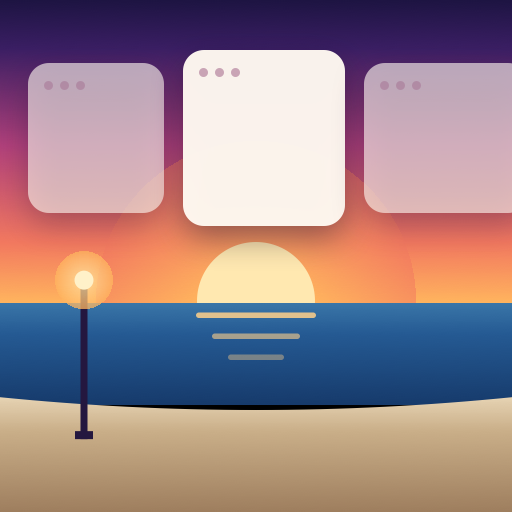

<p align="center">
  
</p>

<h1 align="center">Rambla</h1>

<p align="center">
  A free, open-source <b>scrolling window manager</b> for macOS.<br>
  Your windows line up along an endless horizontal promenade, like the <i>rambla</i> of Montevideo.
</p>

<p align="center"><a href="https://rambla-mac.vercel.app"><b>rambla-mac.vercel.app</b></a> · <a href="README.es.md">Leer en español</a> · <a href="docs/MANUAL.en.md">User manual</a></p>

<p align="center">
  <a href="https://github.com/Coru29/rambla/actions/workflows/ci.yml"></a>
  <a href="LICENSE"></a>
  
</p>

---

Every window is a column on one horizontal strip that keeps going past the edges of your screen. Opening a window adds a column next to the one you are using **instead of shrinking everything else**, and the strip slides to show whatever you focus. It is the [niri](https://github.com/YaLTeR/niri) / PaperWM idea, built as a light native Mac app and inspired by the paid [ChainYourMac](https://chainyourmac.com).

> The interface follows your Mac's language: Spanish or English (any other language gets English). Translations are welcome, see [CONTRIBUTING.md](CONTRIBUTING.md).

## Features

- **One strip per display and per Space**, with spring animations and its own focus and scroll position.
- **New windows open beside the focused one**; the strip scrolls to the focused window (centering: never, only when it overflows, always).
- **Column widths**: presets (25/33/50/66/75 %), full width, wider/narrower, center, and **pin a column** to the left or right edge.
- **Stacks and tabs**: put several windows in one column, stacked vertically or as tabs with a clickable tab bar.
- **Trackpad**: a three- or four-finger swipe slides the strip; a short quick swipe reaches the next column. Swipe up for full width, down to go back.
- **Strip indicator**: a frosted bar with one icon per column while you navigate; click a tile to jump, drag it to reorder.
- **Mouse**: hold ⌃⌘ and turn the wheel to go through the columns; drag a window onto another column to reorder; resize it to set the column width.
- **Focus border** and **dim inactive windows** (optional), focus follows mouse / mouse follows focus (optional).
- **Per-app rules** (tile or float, initial width, where new windows open) and per-display on/off.
- **Remembers the layout** across restarts; launch at login.
- **Plays well with [Rectangle](https://rectangleapp.com)**: default shortcuts use ⌃⌘, so they don't clash with Rectangle's default ⌃⌥ set (with its Spectacle set a couple do, and Rambla tells you), and if Rectangle (or any other app) moves a window, that window leaves the strip and stays where it was put. The Mac page of the settings lists any shortcut that collides with your Rectangle setup.
- **Automation**: `rambla://` URLs, a `rambla` command-line tool and Raycast script export.
- **English and Spanish**: the interface follows your Mac's language.
- **Light**: native Swift (AppKit + SwiftUI settings), no Electron, event-driven — about 0 % CPU and ~12 MB of memory when idle.

## Privacy

Rambla collects no data and has no telemetry. It does not read window contents or record the screen. Its only network request is a check of GitHub for a new release, shortly after it starts and once a day, which you can turn off in Settings → General. See [SECURITY.md](SECURITY.md).

## Requirements

macOS 14 Sonoma or later on Apple silicon, and the Accessibility permission.

## Install

1. Download **[Rambla.dmg](https://github.com/Coru29/rambla/releases/latest/download/Rambla.dmg)** from [Releases](https://github.com/Coru29/rambla/releases) (or build it, below) and drag **Rambla** to Applications.
2. Open it and allow it in **System Settings → Privacy & Security → Accessibility**.
3. Rambla is not notarized by Apple. If macOS says it cannot verify the developer, right-click the app → **Open**, or run `xattr -dr com.apple.quarantine /Applications/Rambla.app`.

### Updates

Rambla checks GitHub when it starts and once a day. When a new version is out, its menu shows **Update to Rambla X…**: it downloads the release, verifies that it is signed with the same certificate, replaces itself and restarts. The Accessibility permission is kept.

## Default shortcuts

All of them can be changed in **Settings → Shortcuts**.

| Shortcut | Action |
|---|---|
| ⌃⌘← / ⌃⌘→ (or ⌃⌘H / ⌃⌘L) | Focus the column to the left / right |
| ⌃⌘↑ / ⌃⌘↓ (or ⌃⌘K / ⌃⌘J) | Focus the window above / below in a stack |
| ⌃⌘A / ⌃⌘E | First / last column |
| ⌃⌘1 … ⌃⌘9 | Jump to column N |
| ⌃⌘⇧ + arrows (or H J K L) | Move the column / the window inside its stack |
| ⌃⌘N | Send the window to the next display |
| ⌃⌘R | Cycle preset widths |
| ⌃⌘M | Full width (again to restore) |
| ⌃⌘C | Center the column |
| ⌃⌘= / ⌃⌘- | Wider / narrower |
| ⌃⌘⇧= / ⌃⌘⇧- | Taller / shorter (in a stack) |
| ⌃⌘0 | Equalize heights |
| ⌃⌘P / ⌃⌘⇧P | Pin the column to the left / right edge |
| ⌃⌘[ / ⌃⌘] | Stack into the column on the left / right |
| ⌃⌘⇧[ / ⌃⌘⇧] | Pop out of the stack to the left / right |
| ⌃⌘⇧T | Toggle stack ⇄ tabs |
| ⌃⌘T | Float / put back in the strip |

## Trackpad

macOS also receives every swipe and Rambla cannot stop it. And in **System Settings → Trackpad → More Gestures → Swipe between full-screen applications**, the three-finger option also keeps the four-finger swipe on. If you use the four-finger swipe (default), click **Turn Off in macOS** in **Settings → Trackpad & Mouse**: Rambla turns off only the macOS four-finger swipe, and three fingers still switch desktops. Or pick three fingers in Rambla and set the system one to four. Rambla tells you if they collide.

## Recommended macOS settings

Rambla checks these for you in **Settings → Mac**:

- **Displays have separate Spaces**: on (macOS default).
- **Automatically rearrange Spaces based on most recent use**: off.
- **Stage Manager** and **drag windows to screen edges to tile**: off.
- With two displays, placing the second one **above or below** the main one works best. Side by side works too: windows only slide halfway toward the other display before they are parked.

## Known limitations

If a display stays disconnected for more than 15 seconds (unplugging a laptop from its dock, for example), its windows join the strip of the display macOS moves them to, and Rambla does not restore that display's arrangement when it comes back.

## Automation

```sh
open -g "rambla://focus-left"        # any action id but close-window, e.g. focus-3, cycle-width
rambla focus-right                   # after Settings → Automation → Install `rambla` Command
rambla list                          # all actions
```

Settings → Automation can also export one Raycast script per action. Any web page can open a `rambla://` link, so links can't close windows: `close-window` runs only from the `rambla` command and from its Raycast script.

## Build from source

Only the Xcode **Command Line Tools** are needed (Swift 6); Xcode itself is not required.

```sh
git clone https://github.com/Coru29/rambla && cd rambla
scripts/test.sh        # unit tests (Swift Testing)
scripts/build.sh       # build/Rambla.app
scripts/dmg.sh         # build/Rambla.dmg
scripts/install.sh     # copy to /Applications and launch
scripts/e2e.sh         # live end-to-end checks with a throwaway test app (needs the Accessibility permission)
```

The first build creates a local self-signed code-signing identity in `.signing/` (never committed), so macOS keeps the Accessibility permission across rebuilds. That identity is yours, not the project's: installing your build over a release makes macOS ask for the Accessibility permission again, and that copy no longer accepts the official updates.

**Versions and releases**: commits follow [Conventional Commits](https://www.conventionalcommits.org) and the version is computed from them (`feat` → minor, `fix` → patch, `!` → major). `scripts/release.sh` builds the signed DMG, tags and publishes the release; installed copies update themselves within a day. See [CONTRIBUTING.md](CONTRIBUTING.md).

## How it works

- `RamblaCore` is a pure Swift library with the model (strips, columns), the layout engine, the strip operations, preferences and shortcut tables. It has no AppKit and is covered by unit tests.
- The app runs **one thread per managed app** for all Accessibility calls, so a frozen app never blocks the others. Everything is event-driven (AX notifications, workspace notifications, Carbon hot keys); timers run only while something needs them: an animation, the strip indicator while ⌃⌘ is held, the permission check until it is granted, and the daily update check.
- macOS moves windows that are fully off screen back into view, so windows outside the visible part of the strip are **parked with 1 pt visible** at a screen edge. When Rambla quits or pauses, every parked window is brought back on screen.
- Private APIs are kept to the minimum that yabai and AeroSpace also use (window ids, Spaces, focusing an exact window), loaded at runtime so a missing symbol degrades instead of crashing. SIP stays on.

## Credits

Inspired by [niri](https://github.com/YaLTeR/niri), [PaperWM](https://github.com/paperwm/PaperWM), [PaperWM.spoon](https://github.com/mogenson/PaperWM.spoon), [Paneru](https://github.com/karinushka/paneru) and [ChainYourMac](https://chainyourmac.com). Techniques learned from [yabai](https://github.com/koekeishiya/yabai), [AeroSpace](https://github.com/nikitabobko/AeroSpace) and [Rectangle](https://github.com/rxhanson/Rectangle).

## License

[MIT](LICENSE)
